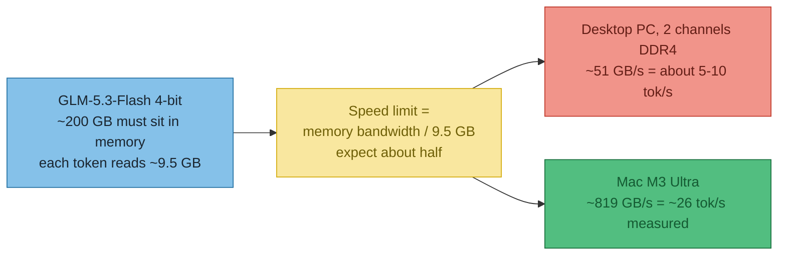
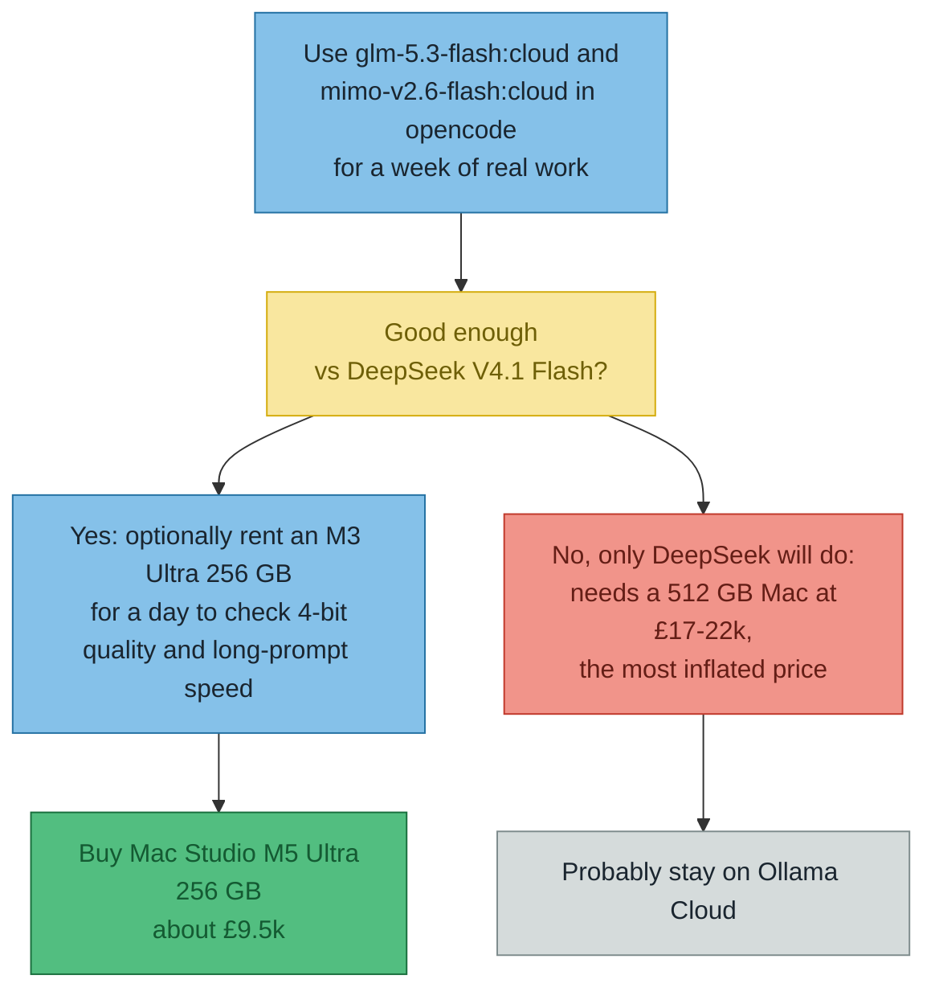

# ADR-014 Self-hosting a coding model: DeepSeek V4.1 Flash or something smaller

**Status:** Parked (2026-11-28). Nothing bought. Staying on Ollama Cloud for now.
**Date:** 2026-11-28
**Follows on from:** [ADR-010](./010-local-model-hardware), which picked a used RTX 3090 for small models and ruled the Mac out because it can't run NixOS. That still holds for my desktop. This ADR is about a separate box that only serves a model over the network, which changes the Mac question.

## The answer

DeepSeek V4.1 Flash, the model I use every day through Ollama Cloud in opencode, is too big to run well at home for less than about £17k. Every cheaper option needs a heavily squashed 2-bit copy, or reads the model off an SSD while it runs, or both.

A smaller model is the better bet. GLM-5.3-Flash fits entirely in a 256 GB Mac Studio (about £9.5k) at 4-bit and runs at roughly 26 to 50 tok/s (tokens per second, roughly words per second). Before buying anything, the plan is a week of real work on `glm-5.3-flash:cloud` through Ollama Cloud. If that isn't good enough, the hardware isn't worth buying.

All prices below are live UK listings from 2026-11-28. Memory and GPU prices are moving weekly, so recheck them before buying.

## Why DeepSeek V4.1 Flash doesn't fit at home

DeepSeek V4.1 Flash has 552 billion parameters plus a 196 billion parameter lookup table it calls "Engram". It's a mixture-of-experts model: each layer has 384 small expert networks and only 6 of them run for any given token. So only about 16 billion parameters are read per token, but all of them still have to be in memory.

| Version | Bits per weight | Size |
|---|---|---|
| Official release | ~4 to 8 | ~511 GB |
| 4-bit (Unsloth UD-Q4_K_XL) | ~4.5 | 501 GB |
| 3-bit (UD-IQ3_XXS) | ~3 | 395 GB |
| 2-bit (UD-IQ2_XXS) | ~2 | 301 GB |
| 1.5-bit (UD-IQ1_S) | ~1.5 | 233 GB |

> Engines can leave the Engram table in normal RAM, or even on SSD, without slowing generation much. That's how the cheap setups squeeze it in.

### Speed comes from memory bandwidth, not the GPU

Every new token reads the active weights out of memory. So speed is capped at memory bandwidth (GB per second the chip can read) divided by the GB read per token. In practice you get about half that cap.



This answers the "does DDR matter?" question. It does, but the number of memory channels matters more than DDR4 vs DDR5. Every desktop board (AM4, AM5, Intel) has two channels. Servers and workstations have eight or twelve.

| Memory setup | Bandwidth | Limit at 4-bit DeepSeek (÷9 GB) |
|---|---|---|
| Desktop, 2 channels DDR5-6000 | ~96 GB/s | ~11 tok/s |
| Old EPYC server, 8 channels DDR4-3200 | ~205 GB/s | ~23 tok/s |
| Strix Halo mini PC | ~256 GB/s | ~28 tok/s |
| DGX Spark | ~273 GB/s | ~30 tok/s |
| EPYC Genoa, 12 channels DDR5-4800 | ~460 GB/s | ~51 tok/s |
| Mac M3 Ultra | ~819 GB/s | ~90 tok/s |

> The bandwidth figures are vendor specs from memory, not re-checked. The limits are my arithmetic. Nobody has published a controlled DDR4 vs DDR5 test on this model.

## DeepSeek V4.1 Flash hardware options

Speeds are single-user output speed. 🟢 means the author published logs, 🟡 means a community report nobody verified, 🔴 means my estimate with nothing measured. Many of the faster community numbers use speculative decoding, where a small draft model guesses ahead and the big model checks its guesses. That makes them look better than a plain run.

| Option | Parts and live price | Total | Fits | Speed |
|---|---|---|---|---|
| Upgrade a gaming PC: 24 GB GPU + 128 GB RAM | Used RTX 3090 [£1,199](https://www.ebay.co.uk/itm/860180253485), 128 GB DDR5 [£2,500](https://www.scan.co.uk/products/128gb-2x64gb-corsair-ddr5-vengeance-black-pc5-41600-5200-non-ecc-unbuffered-cas-40-xmp30-1) | ~£3.7k | 2-bit, read off SSD | 10 to 33 🟢🟡 |
| ~~Used EPYC rack server + 3090~~ (no rack servers) | ~~Dell R7515, 512 GB, [£3,838](https://www.ebay.co.uk/itm/168369974375)~~ | ~~£5k~~ | ~~Full~~ | ~~20 to 35 🔴~~ |
| Self-built dual EPYC DDR4 tower + 2 GPUs | 64 GB DDR4 sticks at [£450](https://www.ebay.co.uk/itm/377661860595), CPUs ~£864 each | ~£8 to 10k | Full | 50 full, 63 at 2-bit 🟢 |
| 2× Strix Halo 128 GB, linked | GMKtec EVO-X2 [£3,300 each](https://www.amazon.co.uk/GMKtec-EVO-X2-Computers-LPDDR5X-8000MHz/dp/B0F6X332N6) | £6.6k | ~2.9-bit | 50 to 60 🟡 |
| Framework Desktop 192 GB | [£6,799](https://frame.work/gb/en/products/desktop-diy-amd-aimax400/configuration/new), pre-order | £6.8k | 2-bit | 15 to 30 🔴 |
| Used Mac Studio M3 Ultra 256 GB | [£7,899](https://www.ebay.co.uk/itm/168809826610) | £7.9k | 2-bit, Engram on SSD | 9.5 to 40 🟢🟡 |
| New Mac Studio M5 Ultra 256 GB | [£9,499](https://www.apple.com/uk/shop/buy-mac/mac-studio) | £9.5k | 4-bit read off SSD | 20 🟢 |
| 2× DGX Spark | Scan bundle [£12,845](https://www.scan.co.uk/products/nvidia-dgx-spark-ai-supercomputer-bundle-2x-nvidia-dgx-spark-1x-qsfp-to-qsfp-112g-32awg-05m-ethernet) | £10.4 to 12.8k | 2 to 3.5-bit | 21 plain 🟢, 55 to 75 speculative 🟡 |
| Used Mac Studio M3 Ultra 512 GB | [£16,999](https://www.ebay.co.uk/itm/168615541237) | £17k | 3-bit, all in memory | 30 to 45 🔴 |
| New Mac Studio M5 Ultra 512 GB | [£22,299](https://www.apple.com/uk/shop/buy-mac/mac-studio) | £22.3k | 4-bit, all in memory | ~64 🟡 (search snippet only) |
| EPYC Genoa + RTX PRO 6000 96 GB | 12× 64 GB DDR5 at [£1,537](https://www.ebay.co.uk/itm/860183220728), GPU [£13,999](https://www.ebay.co.uk/itm/327348345590) | ~£35k | Full | 65 to 86 🟡 |
| NVIDIA DGX Station GB300 | [£107,999](https://www.scan.co.uk/products/msi-xpertstation-ws300t60l-ai-workstation-gb300-blackwell-ultra-748gb-coherent-memory-2x-2tb-ssd-con) | £108k | Full | 90.5 🟢 |

For comparison, hosted APIs serve DeepSeek V4.1 Flash at around 215 to 230 tok/s. Even the £108k box runs at less than half that.

> Most results under £10k come from small one-person engines (Strata, Xolotl, ds4), not llama.cpp or MLX. I found no quality tests of the 2-bit versions.

RAM prices are the other problem. A 64 GB DDR5 server stick costs £1.5k used or £2.4 to 3k new. Apple charges £11,500 to go from 256 GB to 512 GB on the M5 Ultra.

## Smaller models that fit in memory

These fit entirely in memory at 4-bit or better on hardware I could actually buy. That means predictable speed and no 2-bit quality loss. The coding score is DeepSWE v1.1, an agentic coding benchmark. It's the only one every vendor published, but each ran it in their own test setup, so treat gaps under about 5 points as noise.

| Model | Total / active | 4-bit size | DeepSWE | Fits fully on | Local speed (community) | Ollama Cloud (per M tokens in / out) |
|---|---|---|---|---|---|---|
| DeepSeek V4.1 Flash (reference) | 552B + 196B / 16B | ~500 GB | 74.2 | 512 GB Mac | see above | `deepseek-v4.1-flash:cloud` $0.30 / $1.20 |
| GLM-5.3-Flash | 320B / 18B | 157 to 204 GB | 63.4 | 256 GB Mac | M5 Ultra 41, or 74 to 90 speculative. M3 Ultra ~26 | `glm-5.3-flash:cloud` $0.15 / $0.50 |
| MiMo-V2.6-Flash | 309B / 15B | 167 GB at its native precision | not published | 256 GB Mac | M5 Ultra 49 (one report) | `mimo-v2.6-flash:cloud` $0.14 / $0.28 |
| Qwen3.8-Flash-Next | 125B + 51B / 6B | 94 to 112 GB | 58.7 | 128 GB machines | 3090 + RAM ~20 | not listed |
| Qwen3.8-27B | 27B (dense) | ~17 GB | 42.2 | one 24 GB GPU | 3090 ~38 | not listed |
| Qwen3-Coder-Next | 80B / 3B | ~48 GB | n/a | my work PC as-is | Strix Halo 33 to 37 | not listed |

GLM-5.3-Flash is the closest to DeepSeek. It's about 11 points behind on DeepSWE, and about 4 points behind on Terminal-Bench when both run in the same harness. MiMo ships at the precision it fits in, so there's no quantisation loss at all, but I couldn't find comparable coding scores for it.

## Hardware for GLM-5.3-Flash at 4-bit

| Option | Fits 4-bit? | Cost | Speed | |
|---|---|---|---|---|
| Upgrade work PC (128 GB DDR4 + 3090) | No, 152 GB total | ~£1.2k + RAM | 5 to 10 | 🔴 |
| New AM5 desktop, 256 GB DDR5 + 3090 | Yes | ~£7 to 8k | 6 to 10 (est.) | 🔴 |
| Strix Halo 128 GB | No | £3.3k | 19, but only at 3-bit or less | 🔴 |
| Framework Desktop 192 GB | Only the 157 GB version | £6.8k | 15 to 20 (est.) | 🟡 |
| 2× Strix Halo | Yes, split over two boxes | £6.6k | 15 to 25 (est.) | 🟡 |
| 2× DGX Spark | Yes | £10.4 to 12.8k | ~20 to 26 each across 4 chats | 🔴 |
| Mac Studio M3 Ultra 256 GB, used | Yes | £7.9k | ~26 | 🟢 |
| Mac Studio M5 Ultra 256 GB, new | Yes | £9.5k | 41 plain, 74 to 90 speculative | 🟢 |

The PC routes fail for the same reason as before: two memory channels. Mini PCs either can't hold the model at 4-bit or haven't been measured.

> macOS only lets the GPU use part of unified memory by default. The 204 GB MLX build probably needs `sudo sysctl iogpu.wired_limit_mb=<MB>` to fit. That's from memory and resets on reboot.

## My two PCs

I checked both with `dmidecode` and `nvidia-smi`.

| | joel-desktop-work | jollof-home |
|---|---|---|
| Board | ASUS ROG Strix B550-F | MSI MAG B550 Tomahawk |
| CPU | Ryzen 7 5800X, core 6 switched off | Ryzen 7 5800X |
| RAM | 2× 32 GB Corsair 3600 CL18, **running at 2133**, 2 slots free | 4× 8 GB Corsair 3200, all slots full |
| GPU | RTX 3060 12 GB | RTX 2060 6 GB |
| Free disk | 176 GB | 79 GB |

The work PC's RAM is running at its slow default because DOCP (AMD's memory speed profile) is off. That's about 40% of its bandwidth sitting unused. Its core 6 is switched off on purpose in `hosts/joel-desktop-work/configuration.nix` after machine-check crashes on 2026-11-24 and 25. With the RAM at its safest speed, a memory overclock can't be causing those, which points more towards the CPU itself. Fix the crash before turning DOCP on or spending money on this machine.

Both boards top out at 128 GB DDR4. Neither PC is worth upgrading for these models. The work PC could still run Qwen3-Coder-Next today, slowly, which is enough to judge whether a smaller model's answers are good enough.

## Will a Mac lose its value if AI demand crashes?

Mostly the memory part. The M3 Ultra 512 GB launched at $9,499 in the US in March 2025 and now sells used in the UK for £17 to 19k, about double. Apple has since raised its RAM upgrade prices and dropped the 512 GB option on the M3 Ultra. The base M5 Ultra with 96 GB is £5,499, which is roughly normal Mac pricing. The price above that is the part a crash would hit.

| Buy | Price | Inflated memory premium | Rough worst-case loss |
|---|---|---|---|
| M5 Ultra 256 GB | £9,499 | ~£4,000 | ~£4 to 6k |
| M5 Ultra 512 GB | £22,299 | ~£15,500 | ~£12 to 15k |

The losses are my guess, not a forecast. A crash could also cut the other way: if subsidised cloud AI gets pricier or shuts down, a box running models I've already downloaded becomes more useful. Either way it won't pay for itself against cloud prices like $0.15 / $0.50 per million tokens.

> Apple's UK pages contradict each other on whether custom-configured Macs can be returned within 14 days, and UK distance-selling law exempts goods made to your specification. Get the return terms in writing before ordering.

## Testing before buying



Ollama Cloud tests whether the model is good enough. It doesn't tell me how the 4-bit copy behaves, or how fast a Mac reads the long prompts opencode sends (often 50k+ tokens). That prompt-reading speed is a Mac's weak spot, and none of the benchmarks I found measure it properly.

AWS rents the real machine. `mac-m3ultra.metal` is an M3 Ultra Mac Studio with 256 GB, the same as the used £7,899 option. A new M5 Ultra should be roughly 1.6× faster, going by the 41 vs 26 tok/s review figures.

| Catch | Detail |
|---|---|
| Minimum spend | Mac hosts bill for at least 24 hours. At ~$12.50/hr (Vantage, not checked against AWS) that's about $300 |
| Region | us-east-1 and us-west-2 only, no London |
| Quota | Probably needs a Dedicated Host quota increase first, which can take days |
| Software | GLM-5.3-Flash has no local Ollama build (cloud only), so serve it with MLX or llama.cpp and point opencode at that server |
| Teardown | AWS won't release the host before 24 hours, and it bills until released |

Cheaper alternatives, from vendor pages I haven't verified: [AI FAIZ](https://aifaiz.com/) lists an M3 Ultra 256 GB at $3.90/hr. [AI KIZAI](https://ai-kizai.com/) rents an M3 Ultra 512 GB at $299 for 3 days, which would also let me try DeepSeek V4.1 Flash itself.

ARM on its own doesn't help. AWS Graviton is ARM but has no GPU and no unified memory, and MLX only runs on Apple silicon. It has to be a real Mac.

## Measuring speed in opencode

opencode v2 (I'm on 2.2.5) shows `· N tok/s` in the footer of each reply, and it seems to be on by default. If it's missing, set it in `~/.config/opencode/cli.json`, which is a separate file from `opencode.json`:

```json
{
  "$schema": "https://opencode.ai/v2/cli.json",
  "session": { "tps": true }
}
```

The number is output tokens divided by the time from the request starting to the stream ending, so it includes the wait for the first token. It reads lower than pure generation speed, especially on short replies. Ignore the old community plugins (`oc-tps`, `opencode-model-stats`); they were written for opencode v1.

## Decision

Parked. Nothing gets bought until GLM-5.3-Flash or MiMo-V2.6-Flash has had a week of real work on Ollama Cloud.

If one of them holds up, buy a Mac Studio M5 Ultra 256 GB (£9,499), or a used M3 Ultra 256 GB (£7,899) if ~26 tok/s is enough. Don't buy 512 GB: that's only needed for DeepSeek V4.1 Flash, and that memory is the most inflated price in the whole comparison.

Ruled out:

- Upgrading either PC, or buying a new desktop: two memory channels cap the speed.
- Rack servers: I don't want one.
- DGX Sparks: they cost more than the Mac for less speed.
- Strix Halo at 128 GB: it can't hold these models at 4-bit.

## Still open

1. No quality tests exist for 2-bit or 3-bit DeepSeek V4.1 Flash, so the cheap DeepSeek options are a gamble on coding ability.
2. Nobody has published a DeepSeek V4.1 Flash speed for the M3 Ultra 512 GB.
3. The M5 Ultra 512 GB "~64 tok/s" comes from a single search snippet.
4. Prompt-reading speed on a Mac with 50k+ token contexts is unmeasured. The AWS or rented-Mac test would answer it.
5. The work PC crash: is it the CPU, the board or the RAM?

## Sources

All fetched 2026-11-28.

- [DeepSeek V4.1 Flash model card](https://huggingface.co/deepseek-ai/DeepSeek-V4.1-Flash) and [announcement](https://api-docs.deepseek.com/news/news260910/)
- [vLLM recipe](https://recipes.vllm.ai/deepseek-ai/DeepSeek-V4.1-Flash): sizes, Engram offload, the DGX Station run
- [llamaperf](https://llamaperf.com/model/deepseek-v4-1-flash): community-submitted speeds, unverified. Also its [GLM-5.3](https://llamaperf.com/model/glm-5-3-flash), [Qwen3.8](https://llamaperf.com/model/qwen3-8-flash-next), [Qwen3-Coder-Next](https://llamaperf.com/model/qwen3-coder-next) and [MiMo](https://llamaperf.com/model/mimo-v2-6-flash) pages
- [Xolotl](https://github.com/Indras-Mirror/Xolotl): 4090 + 110 GB DDR4 runner
- [KTransformers on dual EPYC](https://github.com/05yuki/deepseek-v4.1-flash-1017-ktransformers)
- [Elite Test Engineering](https://elitetestengineering.substack.com/p/deepseek-v41-flash-optimization-and): DGX Spark and M5 Ultra logs, the most transparent source
- [ModemGuides](https://www.modemguides.com/blogs/ai-infrastructure/run-deepseek-v4-1-flash-locally-hardware-reality-check): quant sizes (has affiliate links)
- [GLM-5.3-Flash](https://huggingface.co/zai-org/GLM-5.3-Flash), [Qwen3.8-Flash-Next](https://huggingface.co/Qwen/Qwen3.8-Flash-Next) and [Qwen3.8-27B](https://huggingface.co/Qwen/Qwen3.8-27B) model cards
- [Featherless comparison](https://featherless.ai/blog/glm-5-3-flash-vs-qwen-3-8-flash-next-vs-qwen-3-8-27b) (an inference vendor)
- [Ollama pricing](https://ollama.com/pricing) and [cloud model list](https://ollama.com/search?c=cloud)
- [AWS EC2 Mac instances](https://aws.amazon.com/ec2/instance-types/mac/) and [user guide](https://docs.aws.amazon.com/AWSEC2/latest/UserGuide/ec2-mac-instances.html); [Vantage price for mac-m3ultra.metal](https://instances.vantage.sh/aws/ec2/mac-m3ultra.metal)
- [The Register on M3 Ultra launch pricing](https://theregister.com/2025/03/05/apple_m3_ultra_mac_studio) and [Notebookcheck on the 512 GB option being dropped](https://www.notebookcheck.net/Apple-increases-RAM-upgrade-pricing-for-M3-Ultra-Mac-Studio-retires-512-GB-option.1244246.0.html)
- [Apple UK returns](https://apple.com/uk/shop/help/returns_refund) and [sales policy](https://apple.com/uk/shop/open/salespolicies)
- [opencode v2 config docs](https://opencode.ai/v2/docs/cli/config/) and [PR #45265](https://github.com/anomalyco/opencode/pull/45265)
