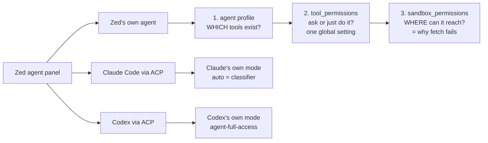
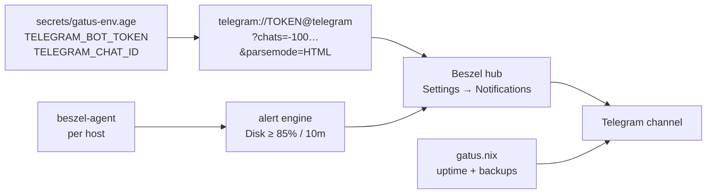

# November 2026

## Firefox fighting with bitwarden
As usual AI had a number of hacky solutions... every time firefox suggestions an email (which IS quite useful sometimes) when i press down to select one bitwarden hijacks it

An elegant but simple solution (over hacking bitwardens extension database to disable autofill, or disabling autofill on firefox). 

Is just to **press up** instead of down 🤣

## Agent Managing
FINALLY getting around to trying this out!

so far... its pretty good but lacking in some features... I guess if you don't try then you don't find out right?

So far my conclusions have been... - agent of empires fits my hacky setup more.... (NOT using supersets relay + pro for $20 pcm, just feels less secure and off)

| Name | Format | Remote | rating |
|---|---|---|---|
| Agent of Empires | Web | tailscale + caddy | 🟢 |
| Superset | IDE | via their relay (only) | 🔴 |


BUT - superset have great support for rendering artifacts in the same IDE which is really really nice

Ok so claude did summarise some points I made (well I prompted it) succinctly about my preference for web + API + server over desktop GUI

### Web preference
1. desktop GUI seems to cater more to the "soy latte macbook" drinker coder and is more succeptible to enshittification (prime example superset only has remote via relay)
2. GUIs are generally buggy and less polished in linux (although this is unfair... if done well they are good)
3. less scriptable than a website - which can be fully replicated by an agent just calling API endpoints
4. desktop doesn't allow for ad-hoc overrides using vimium to fill in the gaps of keys

> something i missed... that what i want is "keyboard first", not a command palette - coming from terminal I want EVERY action to be actionable by a keyboard movement

### Agent of Empires
Also some issues I noticed with agent of empires:
1. key bindings were not particularly intuitive
2. terminal didn't close with the `ctrl-tilde` was toggled
3. the "load earlier messages" button sometimes didn't work
4. no way to "pin" files or documents anywhere
5. needed a separate pages server to serve documents, (ACP doesn't provide one)
6. no way to manage long running shell commands
7. diff view is stale sometimes (doesn't update)


### Codeg
It *seems* like codeg solves alot of these problems itself? It's a much more polished user interface, has a monitor for shells, a sidebar for cuments etc, and is all based in the web

Ok some new problems with codeg now i've tried it:
1. integrated browser is nice, but I can't change focus off it
2. unlike agent of empires, the session selector `ctrl-k` is only for sessions, no unified command palette like agent of empires
3. annoyingly ctrl-k doesnt find sessions that don't have an active tab? having to resort to vimium in the browser but then the default keys fight with firefox (which i could configure tbf)
4. sometimes `ctrl-tab` doesnt work


Ok apparently, the session searcher `ctrl-k` only searches chats WITHIN a session, which is annoying

But some things it added:
1. shows long running shells above the message panel so dont' need tmux
2. remembers sidebar tabs for documents and browsers so can keep them open
3. not strictly necessary, but the tabs feature with `ctrl-tab` to switch from session to session is nice

### Openhands
Openhands is pretty similar to codeg - does seem a (bit) more polished but the same problems... command palette is VERY limited

It does not even have a keybinding to search existing sessions

However, it does (apparently) have a unified viewer of remote sessions which is REALLY nice


## tmux agent pickers
tried two tmux tools for keeping track of agent sessions, each in its own copy of my dev container

so ccmux is the newer one (and still being released) but has less stars

ccmux scores green for interactivity - very clear, nice colours and searchable. opensessions i found hard to see the difference between the sessions and to find where to navigate

going with ccmux - `Alt-p` opens the picker, `prefix S` toggles its sidebar

> gotcha: if the ccmux daemon starts before `~/.claude/projects` exists (fresh container, claude never run) it never picks up claude sessions. `ccmux daemon stop` then start fixes it; the dev image now creates the dir up front

## Zed agent permissions
wanted my `joels-yolo` agent profile to mean "allow everything" on sandbox machines. turns out that's not what agent profiles do at all...

Zed has TWO things called "profiles":
- **agent profile** (`agent.profiles.<name>`): picks *which tools* the agent has. nothing to do with whether it asks first ([docs](https://zed.dev/docs/ai/agent-profiles))
- **settings profile** (top-level `profiles`): a saved set of setting overrides you flip with `settings profile selector: toggle` ([docs](https://zed.dev/docs/configuring-zed))

"ask first or just do it" is `agent.tool_permissions`, and it's ONE global setting: `allow` / `confirm` / `deny` plus regex patterns ([docs](https://zed.dev/docs/ai/tool-permissions)). no "auto" mode like claude code's classifier

and why fetch never worked in the zed chat even with `fetch: allow`? that's a third layer, `agent.sandbox_permissions.network_hosts`. only listed hosts are reachable without a prompt ([docs](https://zed.dev/docs/ai/sandboxing))



claude code and codex over ACP (Agent Client Protocol) skip all three zed layers and use their own permission modes. so claude's auto mode is the actual reason i use ACP in zed. the balance zed's native agent can't give me

### per-machine config? nope
- no `include` / `extends` / `settings.d` in settings.json. open discussion with no maintainer reply: [#54076 Include more settings files](https://github.com/zed-industries/zed/discussions/54076)
- no env var expansion in settings values (only `~` in a couple of glob settings)
- overrides exist for OS (`linux`, `macos`) and release channel (`stable`, `preview`) but NOT host
- `agent` isn't allowed in project `.zed/settings.json` (global-only): [#55671](https://github.com/zed-industries/zed/issues/55671), [discussion #67359](https://github.com/zed-industries/zed/discussions/67359)
- the old per-machine settings issue [#16392](https://github.com/zed-industries/zed/issues/16392) got closed in the feature-request cleanup
- settings profiles have a bug where they [apply before you select them](https://github.com/zed-industries/zed/issues/66888)

nothing on the [roadmap](https://zed.dev/roadmap) about reworking permissions. so for sandbox-only yolo the options are a separate file per host (templating, ugh) or symlink swapping

### Coding agents: bloat and community feedback

GitHub activity checked 26 November 2026. Contributor counts are approximate: GitHub’s contributors API is paginated and excludes people who have not made a commit. Community pros and cons summarize project docs and public user discussions, so treat them as signals rather than a formal survey.

| Name | Bloat | GitHub stats: stars · contributors · last commit | Community pros | Community cons |
|---|---|---|---|---|
| [oh-my-pi](https://github.com/can1357/oh-my-pi) | 🔴 | 39.9k · 400+ · 26 Nov 2026 | Full coding environment with IDE features built in; active development and broad provider/tool support. | Large, fast-moving codebase and many features to configure. A recent user discussion raised concern that default web search sent queries to a third-party service; check providers and network behavior before using it with sensitive prompts. |
| [Pi](https://github.com/earendil-works/pi) | 🟢 | 124k · 300+ · 26 Nov 2026 | Minimal core, works across many model providers, and can be extended with skills and packages. | Deliberately omits features such as sub-agents and plan mode, so matching a fuller agent workflow means adding extensions or building it yourself. |
| [Goose](https://github.com/aaif-goose/goose) | 🟡 | 57k · 400+ · 26 Nov 2026 | Open source, supports many LLMs, and can install tools, edit files, and run commands; available as a CLI or desktop app. | Broader workflow and extension surface may feel heavier than a focused coding CLI; setup and provider/tool configuration add friction. |

Sources: [oh-my-pi README](https://github.com/can1357/oh-my-pi), [Pi README](https://github.com/earendil-works/pi), [Goose README](https://github.com/aaif-goose/goose), [oh-my-pi web-search discussion](https://www.reddit.com/r/PiCodingAgent/comments/1wswvcz/default_web_search_in_ohmypi_has_been_silently/). GitHub figures are rounded; latest commit dates are day-level, not a measure of release cadence.

## Summary

### Web implementations

| Name | Remote | Command palette | Docs viewer | Overall rating |
|---|---|---|---|---:|
| Agent of Empires | 🟢 | 🟡 | 🔴 | 6/10 |
| Codeg | 🟢 | 🔴 | 🟢 | 7/10 |
| OpenHands | 🟢🟢 | 🟡 | ? | 7/10 |
| Paseo | 🟢 | 🟢 | 🟢 | 8/10 |

OpenHands gets two greens for remote support because it includes a remote session switcher.

### tmux agent pickers

GitHub figures checked 25 November 2026.

| Name | Style | Stars | Latest release | Interactivity |
|---|---|---:|---|---|
| [ccmux](https://github.com/epilande/ccmux) | overlay popup selector | 248 | 18 Nov 2026 | 🟢 |
| [opensessions](https://github.com/Ataraxy-Labs/opensessions) | sidebar | 1.2k | 7 Jun 2026 | 🔴 |
| [tmux-agent-sidebar](https://github.com/hiroppy/tmux-agent-sidebar) | sidebar | 581 | 18 Jun 2026 | 🟡 |

### IDEs

| Name | Settings JSON file | Use without sign-in | Sync remote agent sessions | Command palette | Vim mode |
|---|---|---|---|---|---|
| Delta IDE | 🔴 | 🔴 | ? | ? | ? |
| Cursor | 🟢 | 🔴 | ? | 🟢 | 🟢 |
| Zed | 🟢 | 🟢 | 🔴 | 🟢 | 🟢 |
| VS Code | 🟢 | 🟢 | 🟡 | 🟢 | 🟢 |
| T3 Code | 🟢 | 🟢 | ? | 🟢 | 🔴 |

> T3 Code has an editable server settings file at `~/.t3/userdata/settings.json`. Preferences such as appearance are stored separately on each device. [Settings docs](https://github.com/pingdotgg/t3code/blob/main/docs/user/project-settings.md) · [JSON settings example](https://github.com/pingdotgg/t3code/blob/main/docs/user/usage.md)

> VS Code's ACP client can only support one chat.

> Cursor required me to sign in and forced me to upgrade to the latest version during my trial. That feels like a regression for my setup. I want to pin my editor version and keep using Claude and Codex through ACP without depending on another editor account.

### Zed
Ok it is really nice...

Having vim support (seems like good support too, i can close non-editor windows with `:q` etc...) is lovely

But it keeps stopping responding? like keys do nothing until i click? Colleague suggests `Ctrl F6`

ahhhh fucking hell! it has its own vim mode for terminal! meaning i can use `ctrl shift space` to go back in the zed temrinal to copy! ah thats nice

## Documentation editors: five tools, one document

This started because I wanted somewhere to keep project docs — a water sports event I'm scoping — and kept bouncing between tools. What I actually wanted: one page, nice to read, and I can just click and type in it.

I ended up with five running at once, all pointed at the same markdown file. Screenshots are all the same document at 1440px wide.

### The screenshots

**TinaDocs** — the best-looking of the lot.


**SilverBullet** — lightest, edits in place, but it reads like an editor.


**Docmost** — click and type, Notion-ish. Note the very long line length.


**CollabMD** — source on the left, preview on the right. Two panes.


**OpenKnowledge** — the surprise. File tree, document, and outline all visible, and editable in place.


### The comparison

| Tool | Reading | Editing | Files on disk (git) | Remote (no tunnel) | Extra services | RAM |
|---|---|---|---|---|---|---|
| TinaDocs | 🟢 best | 🔴 separate `/admin` app | 🟢 MDX in the repo | 🔴 needs TinaCloud or a tunnel | Next dev + Tina API | ~530 MB |
| Docmost | 🟢 good | 🟢 click and type | 🔴 Postgres | 🟢 | Postgres + Redis | ~300 MB |
| OpenKnowledge | 🟢 good + outline | 🟢 click and type | 🟢 markdown | 🟢 | none (one node process) | ~96 MB |
| SilverBullet | 🟡 plain | 🟢 click and type | 🟢 markdown | 🟢 | none | ~88 MB |
| CollabMD | 🟡 preview only | 🟡 source/preview split | 🟢 markdown | 🟢 | one container | ~55 MB |

### Which ones are git-native?

Four of the five keep the document as a markdown file on disk, so the folder can just be a git repo and everything works: SilverBullet, CollabMD, OpenKnowledge and TinaDocs.

Docmost is the odd one out. Pages are rows in Postgres (the body is TipTap JSON, not markdown), and attachments go in its own data volume. You can export pages or a whole space to Markdown, but it's an export, not the storage format. That means no `git diff`, no PR review, no editing the same file from an agent with `sed`.

That's the real trade-off with Docmost: it feels the best to use, and it's the only one that isn't just files.

### Is it heavy?

No. Docmost is the heaviest at about 300 MB across three containers, plus ~1.2 GB of images. On a 31 GB box that's nothing. The real cost isn't RAM, it's moving parts: Postgres and Redis to keep alive, and content that lives in a database instead of a folder.

OpenKnowledge is one node process at ~96 MB and gives most of the same editing experience. If I cared about weight I'd pick that over Docmost.

### What was wrong with each

**TinaDocs** — gorgeous, and the right-hand TOC is the thing that makes it readable. But it's a publishing pipeline: the site and the editor are two separate apps. The admin is a Vite dev server hardcoded to `http://localhost:4001`, so editing from another device means port forwarding or paying for TinaCloud. That's the whole problem in one sentence: reading great, writing awkward.

**SilverBullet** — trivially light, files on disk, no build step. But the default reading experience is an editor pretending to be a document: no TOC, no breadcrumbs, wide empty margins. Space Style can improve the typography but not the structure.

**Docmost** — actually pleasant to write in, and everything is one page. Two gripes: the content column is very wide at 1440px (line length kills scanning), and the outline isn't visible in read mode by default. Data lives in Postgres, so it isn't portable in the same way.

**CollabMD** — the split source/preview view is honest but it means there's no proper reading surface. Fine for editing, not for reading. Also no MCP comment tools.

**OpenKnowledge** — tree, document and outline in one screen, no separate admin, no auth (tailnet only, which is fine here). Newest and least proven of the five, and frontmatter round-tripping is unverified. But on the screenshot test it's the closest to "nice to read and I can just type".

### Verdict

- Reading only, best presentation: **TinaDocs**.
- Reading and writing in one place: **OpenKnowledge**, then Docmost.
- Lightest thing that works: **SilverBullet**.
- If I ever want a public docs site: build TinaDocs statically and serve it, don't run its admin.

If the docs have to stay as files in git — which they should, because then agents can edit them and I can diff them — then **Docmost is out** despite feeling the best. That leaves **OpenKnowledge** as the read-and-write-in-one-place option, with SilverBullet as the boring fallback.

## Beszel alerts → Telegram
Wanted a "disk is filling up" alert. Beszel does this natively, but none of it is declarative: the NixOS module only takes `host`/`port`/`environment`, and the hub's `config.yml` only describes systems (and deletes any not listed). Alert rules and notification URLs live in PocketBase's SQLite under `/var/lib/beszel-hub`, so they're set once in the UI and survive deploys.

Reused the bot gatus already uses — same `TELEGRAM_BOT_TOKEN` and `TELEGRAM_CHAT_ID` out of `secrets/gatus-env.age`. A token identifies the bot, not the chat, so any chat with the bot in it can be a target.

The URL (`Settings → Notifications` in the hub) is just those two values in Shoutrrr form:

```
telegram://<TELEGRAM_BOT_TOKEN>@telegram?chats=<TELEGRAM_CHAT_ID>&parsemode=HTML
```

The `chats` id must keep its leading minus (`-100…`). Dropping it fails with `Bad Request: chat not found` even though the token is fine — that was the whole original problem.

Then the bell icon in the systems table: threshold per metric plus "for X minutes", and multi-select systems to copy the same rule to all of them. Set `Disk ≥ 85% for 10m` on all nine systems; the disk rule watches whichever filesystem is fullest (root, extra mounts, ZFS).



Two gotchas for next time: hub errors are in `auxiliary.db` → `_logs`, not the journal (so `journalctl` looks empty even when a send failed), and the Test button doesn't save the URL — it has to be added and saved explicitly.

If this ever has to be in git, the only path is a `preStart`/oneshot poking the PocketBase API (`alerts` collection, `user_settings.settings.webhooks`); the API shape shifts between minor versions, so it isn't worth it for two settings.
